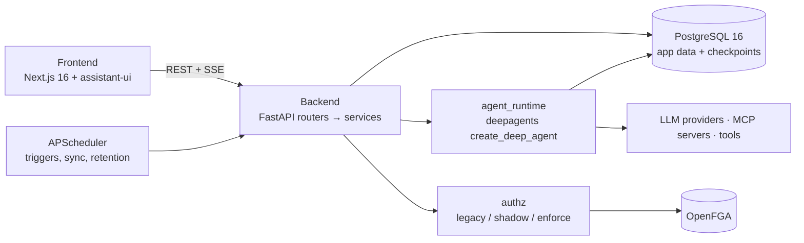

<div align="center">


# Moldy

**A self-hosted, no-code AI agent builder: describe an agent, chat with it, schedule it, and share it inside your organization.**

[]()
[]()
[]()
[]()
[]()
[]()
[](LICENSE)

[한국어](README_KO.md) · English · [Contributing](CONTRIBUTING.md) · [Security](SECURITY.md)

[Features](#features) · [Quick start](#quick-start) · [Local development](#local-development) · [Configuration](#configuration) · [Architecture](#architecture) · [Testing](#testing) · [Docs](#documentation)

<!-- project-current-source: migration=i08_outbox_request_enqueue; deepagents=0.7.11; ruff=0.16.5; refreshed=2026-10-21 -->

</div>

---

## What is Moldy?

Moldy is an open-source web application for building AI agents without writing
code. You describe what you want, a conversational builder proposes the model,
tools, skills, MCP servers and schedule, and you then chat with the resulting
agent, run it on a schedule, or call it through an API.

It is built for teams. Users belong to a company (tenant) and one or more
organizations, resources can be shared with people, groups or whole
organizations, and permission checks can be moved step by step from the
original owner checks to an OpenFGA model.

| | |
|---|---|
| Frontend | Next.js 16 (App Router), React 19, TailwindCSS v4, shadcn/ui, assistant-ui, TanStack Query, Jotai, next-intl |
| Backend | FastAPI, SQLAlchemy 2.0 async, Alembic, APScheduler, Python 3.12 |
| Agent runtime | LangChain 1.x, LangGraph 1.x, `deepagents` 0.7.11 (`create_deep_agent`), LangGraph `AsyncPostgresSaver` |
| Data | PostgreSQL 16, Alembic head `i08_outbox_request_enqueue` |
| Authorization | Owner checks (legacy) or OpenFGA (shadow / enforce), optional PostgreSQL row-level security |
| License | MIT |

## Features

### Chat

- **Streaming runs.** The v3 chat starts runs with an agent-protocol `run.start`
  command and streams events over SSE. A dropped stream resumes from its event
  cursor, and messages typed during a run are queued.
- **Branching.** Editing a user message or regenerating a reply forks the
  LangGraph checkpoint; `<N/M>` arrows switch between sibling branches.
- **Human-in-the-loop.** Approval cards for risky tool calls let you approve,
  reject or edit the arguments, limited to the decisions each tool allows.
  Several pending calls can be approved at once. Agents can also ask you
  questions (`ask_user`).
- **Generative UI.** Tool results can render as tables, charts, stat tiles or
  terminal output instead of raw JSON.
- **Attachments.** Uploaded files show as thumbnails on the message and in the
  conversation file list. Text files are given to the model as context; images
  are displayed but not yet sent to the model.
- **Find, export and retry.** Ctrl/Cmd+F searches the conversation,
  conversations export to Markdown or JSON, and a failed run shows the error
  with a retry button.
- **Long conversations.** Context compaction leaves a summary marker, and the
  composer shows a context-window gauge. Pinned conversation summaries and an
  outline in the right rail help with navigation.
- **Subagents.** Delegated subagents appear as named cards and a team strip.
- **Side chat.** Select text in a reply to open a separate side conversation
  that quotes it.
- **Share links and traces.** A read-only `/shared/<id>` page for a
  conversation, a per-conversation trace view, per-message token usage with
  TTFT and tokens per second, and optional LangSmith and Langfuse export.
- **MCP Apps.** UI resources provided by MCP servers render inside the chat.

### Building agents

- **Three ways to create an agent:** the conversational builder (a meta-agent
  that interviews you and proposes options), a manual form, or a template.
- **Runtime policy.** An agent's runtime policy is versioned. Each conversation
  keeps an immutable snapshot of the policy it started with
  ([ADR-022](docs/design-docs/adr-022-runtime-policy-lifecycle.md)).
- **Models.** Model discovery through a credential, model tests and health
  status, and a fallback list per agent. Operators choose the system models for
  the builder, assistant and image generation (`text_primary`,
  `text_fallback`, `image`).
- **Assistant panel.** An in-app assistant that helps edit an agent's
  configuration.

### Tools, skills and MCP

- **Built-in tools:** web search, web scraper, current date and time, Tavily,
  Naver and Google search, Gmail, Google Calendar, Google Chat webhook, HTTP
  request.
- **MCP servers** over stdio, SSE or Streamable HTTP, with registry presets, a
  tool probe before saving, and MCP OAuth.
- **Skills.** A skill is a `SKILL.md` plus files. Skills can be written in an
  editor, uploaded as `.skill` packages, or built by chatting in the skill
  builder (`/skills/builder`). Each skill has a studio with source, versions and
  rollback, evaluation (including a with/without-skill comparison and cost) and
  user feedback. Skill scripts run through `execute_in_skill`, which asks for
  approval by default.

### Marketplace, artifacts, memory, API and schedules

- **Marketplace.** Publish skills, MCP server templates and agent specs; install
  them as independent copies, bind credentials at install time; operators
  moderate submissions.
- **Artifacts.** Files the agent writes are listed in `/artifacts` and previewed
  in the chat's right rail.
- **Memory.** User and agent memory with settings, proposals that need approval,
  and a recall chip in chat. Agents also have a shared memo.
- **Agent API.** Deploy an agent behind API keys and call it from other systems
  ([docs/agent-api.md](docs/agent-api.md)).
- **Schedules.** Cron and interval triggers with run limits, end dates,
  auto-pause after repeated failures, and run history.

### Organizations and permissions

The organization and authorization layer
([ADR-023](docs/design-docs/adr-023-org-authz.md)) is merged, but its stricter
behaviour is off by default (`AUTHZ_MODE=legacy`, `DB_RLS_ENABLED=false`).
Existing installs are moved into a default company and default organization on
upgrade.

- **Companies and organizations.** A company (tenant) contains organizations,
  members, groups and roles. Users switch organizations from the sidebar.
  `DEPLOYMENT_MODE` selects a single company (`single_tenant`) or SaaS
  (`multi_tenant`).
- **Invitations and sign-up policy.** Organization and company invitations
  (`/invite/<token>`); `REGISTRATION_POLICY` is `default_org`, `personal_tenant`,
  `invite_only` or `closed`. `personal_tenant` (`multi_tenant` only) gives every
  uninvited sign-up its own company and organization, which that person
  administers, so strangers are separated by the company boundary.
- **Sharing.** Agents, skills, tools, MCP servers and credentials can be shared
  with users, groups or organizations. Each resource has an access list and
  ownership transfer.
- **OpenFGA.** Permissions are modelled in
  [`backend/app/authz/model.fga`](backend/app/authz/model.fga). The rollout goes
  `legacy` → `shadow` (OpenFGA decisions are only recorded and compared) →
  `enforce`, one resource type at a time with `AUTHZ_ENFORCE_TYPES`. Operators
  watch sync status at `/settings/admin/authz`.
- **Readiness and connections.** Before a run, Moldy checks that the agent's
  credentials and connections are usable and shows what is missing.
  Credentials can be shared or per user; when a tool needs your own login, the
  chat shows an `auth_required` card to connect it.
- **Access requests and notifications.** Users can request access to a
  resource; admins review requests at `/settings/organization/requests`. A
  notification bell sits in the sidebar.
- **Audit and usage limits.** Audit events, usage reports, and spend limits per
  company, organization, user and agent (warnings at 80%, blocked at 100%).
- **Company SSO.** OIDC and LDAP/Active Directory, DNS domain verification,
  just-in-time provisioning and group-to-role mapping.
- **Data isolation.** Optional company-scoped PostgreSQL row-level security,
  per-company data keys, company export, scheduled deletion and purge, and a
  production startup check that refuses plaintext internal connections unless
  allowed.
- **Admin screens.** Company (`/settings/company`: members, models, policies,
  SSO), organization (`/settings/organization`: members, groups, roles,
  catalog, requests) and platform (`/settings/admin/tenants`, `multi_tenant`
  only).

### Credentials

- **Cipher V2.** Credential payloads are encrypted with HKDF-SHA256 and
  AES-256-GCM, with multiple keys and scheduled rotation to the active key.
- **System and user credentials.** Operators manage system credentials; users
  manage their own at `/credentials`. Vault or environment references are
  supported for external secrets.
- **Korean services.** Definitions for SRT, KTX, Forest Trip, KIPRIS, DART,
  ODsay, Coupang Partners and the K-Skill proxy.

## Quick start

You need Docker with Compose. From a fresh clone:

```bash
git clone https://github.com/YooSuhwa/natural-mold.git
cd natural-mold
docker compose up -d --build
```

This one command builds and starts PostgreSQL, OpenFGA with a one-time
bootstrap, the database migrations, the backend and the frontend. Permissions
still start in `legacy` mode. Then:

1. Open http://localhost:3000/register and create an account. The Docker stack
   has no seeded account, and while `ALLOW_FIRST_USER_AS_ADMIN=true` (the
   default) the first account becomes the operator (`super_user`). Turn it off
   once the operator exists.
2. Add an LLM key at `/settings/system-credentials` (OpenAI, Anthropic, Google,
   OpenRouter or any OpenAI-compatible endpoint).
3. Pick the system models at `/settings/system-llm`. The builder, assistant and
   image generation return an explicit error until this is set.
4. Attach credentials to the models agents will use at `/settings/models`, then
   create an agent from `/agents`.

See [docs/docker-quickstart.md](docs/docker-quickstart.md) for what the stack
contains, how to change host ports (for example `MOLDY_POSTGRES_PORT`) and how
to start over (`docker compose down -v` deletes the volumes). For production
settings (secrets, secure cookies, TLS), read
[docs/operator-setup.md](docs/operator-setup.md) and
[docs/org-authz-operations.md](docs/org-authz-operations.md).

## Local development

Requirements: [uv](https://docs.astral.sh/uv/) (installs Python 3.12),
Node.js 22 (`.node-version`) with [pnpm](https://pnpm.io/), and Docker for
PostgreSQL.

```bash
# Database
docker compose up -d postgres

# Backend (http://localhost:8001/docs)
cd backend
cp .env.example .env            # set ENCRYPTION_KEYS and JWT_SECRET
uv sync
uv run alembic upgrade head     # head: i08_outbox_request_enqueue
uv run uvicorn app.main:app --reload --reload-dir app --port 8001

# Frontend (http://localhost:3000), in another terminal
cd frontend
cp .env.example .env.local      # NEXT_PUBLIC_API_BASE_URL=http://localhost:8001
pnpm install
pnpm dev
```

`backend/.env.example` turns on `E2E_SEED_USER_ENABLED`, which creates a local
Playwright `super_user` at startup (skipped when `APP_ENV=production`). Because
that account exists before you register, you will not be the first user: sign
in with the E2E account, or disable the seed before the first start.

**Worktrees.** In a git worktree, run `bash scripts/worktree-setup.sh` once. It
links `backend/.env` to the main checkout so all worktrees share the same
database, `ENCRYPTION_KEYS` and `JWT_SECRET`. When running several backends,
keep the frontend port, backend port, `CORS_ALLOWED_ORIGINS` and
`NEXT_PUBLIC_API_BASE_URL` matched, and fix the port with
`pnpm dev -- --port <port>`. Several backends on one database can run scheduled
jobs twice.

## Configuration

The full list is in [`backend/.env.example`](backend/.env.example). The most
important settings:

| Variable | Default | Notes |
|---|---|---|
| `DATABASE_URL`, `DATABASE_URL_SYNC` | local `moldy` DB | Async URL for the app, sync URL for the LangGraph checkpointer. Set both when you change the database. |
| `ENCRYPTION_KEYS` | none | Comma-separated 64-character hex keys; the first one is active. `python -c "import secrets; print(secrets.token_hex(32))"` |
| `JWT_SECRET` | none | Signs access tokens. |
| `APP_ENV` | `dev` | `production` enables startup safety checks and skips dev seeding. |
| `ALLOW_FIRST_USER_AS_ADMIN` | `true` | First registered user becomes `super_user`. |
| `REGISTRATION_POLICY` | `default_org` | `default_org`, `personal_tenant` (`multi_tenant` only), `invite_only` or `closed`. |
| `DEPLOYMENT_MODE` | `single_tenant` | `multi_tenant` enables platform company management. |
| `AUTHZ_MODE` | `legacy` | `legacy`, `shadow` or `enforce`. |
| `AUTHZ_ENFORCE_TYPES` | empty | Types enforced in `enforce` mode. Empty means all types. |
| `OPENFGA_API_URL`, `OPENFGA_API_TOKEN`, `OPENFGA_STORE_ID`, `OPENFGA_MODEL_ID` | `http://openfga:8080`, empty | Needed from `shadow` on. Store and model IDs come from `python -m app.authz.cli bootstrap`. |
| `DB_RLS_ENABLED` | `false` | Company-scoped row-level security; turn on only after the database role split in the operator guide. |
| `CORS_ALLOWED_ORIGINS` | `http://localhost:3000,...` | Must include every frontend origin. |
| `NEXT_PUBLIC_API_BASE_URL` | `http://localhost:8001` | Frontend; inlined into the bundle at build time. |

LLM keys are best added in the UI. In development, `OPENAI_API_KEY`,
`ANTHROPIC_API_KEY` and similar variables are copied into system credentials at
startup; production skips this. Tool keys (Tavily, Naver, Google) are described
in [docs/tool-setup-guide.md](docs/tool-setup-guide.md).

## Architecture



- Backend layers: `routers/` (HTTP and permission policy) → `services/`
  (business logic) → `models/` (SQLAlchemy).
- `agent_runtime/` assembles models, tools, skills, memory, subagents and
  middleware, runs them with `create_deep_agent`, and turns LangGraph events
  into SSE.
- Authorization data lives in PostgreSQL; OpenFGA holds a derived copy kept in
  sync through an outbox.
- Frontend: `lib/api/` → TanStack Query hooks → components; client state in
  Jotai.

More detail: [docs/ARCHITECTURE.md](docs/ARCHITECTURE.md).

## Testing

| Suite | Command | Typical time |
|---|---|---|
| Backend unit (SQLite in memory) | `cd backend && uv run pytest -n 4` (up to `-n 8` on a fast machine) | about 5–7 min |
| Backend lint | `cd backend && uv run ruff check .` (Ruff 0.16.5) | seconds |
| Frontend unit (vitest) | `cd frontend && pnpm test -- --run` | about 2.5 min |
| Frontend checks | `pnpm lint`, `pnpm exec tsc --noEmit`, `pnpm build` | a few minutes |
| Native PostgreSQL lane (needs Docker) | `bash scripts/run-isolated-postgres-tests.sh all --manifest <file>.json` | about 6 min with the cached template database (PR #315); longer without it |
| E2E (Playwright) | `cd frontend && pnpm test:e2e` | depends on the project |

- The PostgreSQL lane starts a throwaway PostgreSQL 16 container, migrates it,
  runs the integration tests, and records what it created so it can be cleaned
  up. Check the cleanup with
  `cd backend && uv run python ../scripts/check-isolation-cleanup.py ../<file>.json`.
- `tests/integration/` is excluded from the default pytest run; run it with
  `-m integration`.
- E2E uses a scripted model by default, so no LLM key is needed. Port isolation
  and the seeded account are described in [CLAUDE.md](CLAUDE.md).
- CI runs the backend, PostgreSQL, type-check, frontend, OpenFGA model and E2E
  smoke jobs in parallel; a full run takes about 20 minutes.
- `git push` runs the `.husky/pre-push` hook (backend pytest and frontend vitest).

## Documentation

| Document | Contents |
|---|---|
| [docs/docker-quickstart.md](docs/docker-quickstart.md) | Running the full stack with Docker Compose |
| [docs/operator-setup.md](docs/operator-setup.md) | Production setup, first operator, TLS, RLS |
| [docs/org-authz-operations.md](docs/org-authz-operations.md) | Rolling out organizations and OpenFGA permissions |
| [docs/ARCHITECTURE.md](docs/ARCHITECTURE.md) | System architecture |
| [docs/PRD.md](docs/PRD.md), [docs/PRD-screens.md](docs/PRD-screens.md) | Product requirements and screens |
| [docs/design-docs/index.md](docs/design-docs/index.md) | Architecture decision records (ADR-001 to ADR-023) |
| [docs/exec-plans/index.md](docs/exec-plans/index.md) | Execution plans |
| [docs/marketplace-resources-prd.md](docs/marketplace-resources-prd.md) | Marketplace |
| [docs/agent-api.md](docs/agent-api.md) | Agent API |
| [docs/tool-setup-guide.md](docs/tool-setup-guide.md) | Keys for built-in tools |
| [docs/e2e-coverage.md](docs/e2e-coverage.md) | E2E coverage |
| [CLAUDE.md](CLAUDE.md), [frontend/AGENTS.md](frontend/AGENTS.md) | Developer conventions |

## Contributing and license

See [CONTRIBUTING.md](CONTRIBUTING.md). Report security issues as described in
[SECURITY.md](SECURITY.md).

[MIT](LICENSE). Copyright (c) 2026 Moldy contributors.
