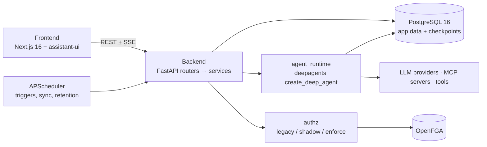

<div align="center">


# Moldy

**직접 설치해 쓰는 노코드 AI 에이전트 빌더. 에이전트를 말로 설명해 만들고, 대화하고, 일정에 맞춰 실행하고, 조직 안에서 공유합니다.**

[]()
[]()
[]()
[]()
[]()
[]()
[](LICENSE)

한국어 · [English](README.md) · [기여 가이드](CONTRIBUTING.md) · [보안](SECURITY.md)

[기능](#기능) · [빠른 시작](#빠른-시작) · [로컬 개발](#로컬-개발) · [설정](#설정) · [아키텍처](#아키텍처) · [테스트](#테스트) · [문서](#문서)

<!-- project-current-source: migration=i09_token_usage_credential_scope; deepagents=0.7.11; ruff=0.16.5; refreshed=2026-10-21 -->

</div>

---

## Moldy란

Moldy는 코드 없이 AI 에이전트를 만드는 오픈소스 웹 애플리케이션입니다. 원하는
일을 설명하면 대화형 빌더가 모델, 도구, 스킬, MCP 서버, 일정을 제안합니다. 만든
에이전트와는 채팅으로 대화하거나, 일정에 맞춰 실행하거나, API로 호출할 수 있습니다.

팀 단위 사용을 전제로 합니다. 사용자는 회사(tenant)와 하나 이상의 조직에 속하고,
자원을 사람·그룹·조직 단위로 공유할 수 있습니다. 권한 판정은 기존 소유자 판정에서
OpenFGA 모델로 단계적으로 옮길 수 있습니다.

| | |
|---|---|
| 프론트엔드 | Next.js 16 (App Router), React 19, TailwindCSS v4, shadcn/ui, assistant-ui, TanStack Query, Jotai, next-intl |
| 백엔드 | FastAPI, SQLAlchemy 2.0 async, Alembic, APScheduler, Python 3.12 |
| 에이전트 런타임 | LangChain 1.x, LangGraph 1.x, `deepagents` 0.7.11 (`create_deep_agent`), LangGraph `AsyncPostgresSaver` |
| 데이터 | PostgreSQL 16, Alembic head `i09_token_usage_credential_scope` |
| 권한 | 소유자 판정(legacy) 또는 OpenFGA(shadow / enforce), 선택적 PostgreSQL 행 단위 보안(RLS) |
| 라이선스 | MIT |

## 기능

### 채팅

- **스트리밍 실행.** v3 채팅은 에이전트 프로토콜의 `run.start` 명령으로 실행을
  시작하고 SSE로 이벤트를 받습니다. 연결이 끊기면 이벤트 커서부터 이어 받고, 실행
  중에 입력한 메시지는 대기열에 들어갑니다.
- **분기.** 사용자 메시지를 고치거나 답변을 다시 생성하면 LangGraph 체크포인트가
  갈라집니다. `<N/M>` 화살표로 형제 분기를 오갑니다.
- **사람 승인(HITL).** 위험한 도구 호출은 승인 카드에서 승인·거부하거나 인자를 고칠
  수 있고, 도구마다 허용된 결정만 보입니다. 대기 중인 호출 여러 건을 한 번에 승인할
  수도 있습니다. 에이전트가 사용자에게 질문(`ask_user`)할 수도 있습니다.
- **생성형 UI.** 도구 결과를 JSON 대신 표, 차트, 수치 카드, 터미널 출력으로 보여 줍니다.
- **첨부.** 올린 파일은 메시지의 썸네일과 대화 파일 목록에 나옵니다. 텍스트 파일은
  모델에 맥락으로 들어가고, 이미지는 화면에만 보이며 아직 모델에 전달되지 않습니다.
- **찾기, 내보내기, 다시 시도.** Ctrl/Cmd+F로 대화 안을 찾고, 대화를 Markdown이나
  JSON으로 내보내며, 실패한 실행은 오류와 함께 다시 시도 버튼을 보여 줍니다.
- **긴 대화.** 맥락 압축(compaction) 뒤에는 요약 표시가 남고, 입력창에 컨텍스트 창
  사용량 게이지가 있습니다. 고정한 대화 요약과 오른쪽 레일의 개요로 위치를 찾습니다.
- **서브에이전트.** 위임받은 서브에이전트가 이름이 붙은 카드와 팀 스트립으로 보입니다.
- **사이드 채팅.** 답변의 텍스트를 선택해 그 부분을 인용한 별도 대화를 엽니다.
- **공유 링크와 추적.** 읽기 전용 `/shared/<id>` 페이지, 대화별 추적(trace) 화면,
  메시지별 토큰 사용량(TTFT, 초당 토큰 포함), 선택적 LangSmith·Langfuse 전송.
- **MCP Apps.** MCP 서버가 제공하는 UI 리소스를 채팅 안에 그립니다.

### 에이전트 만들기

- **세 가지 생성 방법:** 대화형 빌더(요구 사항을 묻고 선택지를 제안하는 메타 에이전트),
  직접 입력 양식, 템플릿.
- **런타임 정책.** 에이전트의 런타임 정책은 버전으로 관리되고, 대화마다 시작 시점의
  정책 스냅숏을 바꾸지 않고 유지합니다([ADR-022](docs/design-docs/adr-022-runtime-policy-lifecycle.md)).
- **모델.** 자격 증명으로 모델 목록 가져오기, 모델 테스트와 상태 확인, 에이전트별
  대체 모델 목록. 운영자는 빌더·어시스턴트·이미지 생성에 쓸 시스템 모델
  (`text_primary`, `text_fallback`, `image`)을 고릅니다.
- **어시스턴트 패널.** 에이전트 설정 편집을 돕는 앱 내 어시스턴트.

### 도구, 스킬, MCP

- **내장 도구:** 웹 검색, 웹 스크래퍼, 현재 날짜·시각, Tavily, 네이버·Google 검색,
  Gmail, Google Calendar, Google Chat 웹훅, HTTP 요청.
- **MCP 서버:** stdio, SSE, Streamable HTTP 전송. 레지스트리 프리셋, 저장 전 도구 확인,
  MCP OAuth를 지원합니다.
- **스킬.** 스킬은 `SKILL.md`와 부속 파일입니다. 편집기에서 직접 쓰거나 `.skill`
  패키지로 올리거나, 스킬 빌더(`/skills/builder`)와 대화하며 만듭니다. 스킬마다 소스,
  버전과 되돌리기, 평가(스킬 있음/없음 비교와 비용 포함), 사용자 피드백을 다루는
  스튜디오가 있습니다. 스킬 스크립트는 `execute_in_skill`로 실행되며 기본적으로 승인을
  거칩니다.

### 마켓플레이스, 아티팩트, 기억, API, 일정

- **마켓플레이스.** 스킬, MCP 서버 템플릿, 에이전트 명세를 게시하고 독립된 사본으로
  설치합니다. 설치할 때 자격 증명을 연결하고, 게시물은 운영자가 검토합니다.
- **아티팩트.** 에이전트가 쓴 파일은 `/artifacts`에 모이고 채팅 오른쪽 레일에서
  미리 봅니다.
- **기억.** 사용자·에이전트 기억과 설정, 승인이 필요한 기억 제안, 채팅의 회상 칩.
  에이전트에는 공유 메모도 있습니다.
- **Agent API.** 에이전트를 API 키 뒤에 배포해 다른 시스템에서 호출합니다
  ([docs/agent-api.md](docs/agent-api.md)).
- **일정.** cron·간격 트리거, 실행 횟수 한도, 종료 시각, 연속 실패 시 자동 일시 중지,
  실행 이력.

### 조직과 권한

조직·권한 계층([ADR-023](docs/design-docs/adr-023-org-authz.md))은 머지되어 있지만
엄격한 동작은 기본으로 꺼져 있습니다(`AUTHZ_MODE=legacy`, `DB_RLS_ENABLED=false`).
기존 설치는 업그레이드할 때 기본 회사와 기본 조직으로 옮겨집니다.

- **회사와 조직.** 회사(tenant) 아래에 조직, 구성원, 그룹, 역할이 있습니다. 조직은
  사이드바에서 바꿉니다. `DEPLOYMENT_MODE`로 단일 회사(`single_tenant`)와
  SaaS(`multi_tenant`)를 고릅니다.
- **초대와 가입 정책.** 조직·회사 초대(`/invite/<token>`). `REGISTRATION_POLICY`는
  `default_org`, `personal_tenant`, `invite_only`, `closed` 중 하나입니다.
  `personal_tenant`(`multi_tenant` 전용)는 초대 없이 가입한 사람마다 그 사람이 관리하는
  개인 회사와 조직을 만들어, 모르는 사용자끼리 회사 경계로 분리합니다.
- **공유.** 에이전트, 스킬, 도구, MCP 서버, 자격 증명을 사용자·그룹·조직과 공유합니다.
  자원마다 접근 목록과 소유권 이전이 있습니다.
- **OpenFGA.** 권한 모델은 [`backend/app/authz/model.fga`](backend/app/authz/model.fga)에
  있습니다. `legacy` → `shadow`(OpenFGA 판정은 기록·비교만) → `enforce` 순으로 옮기고,
  `AUTHZ_ENFORCE_TYPES`로 자원 유형을 하나씩 강제합니다. 동기화 상태는
  `/settings/admin/authz`에서 봅니다.
- **실행 준비와 연결.** 실행 전에 에이전트의 자격 증명과 연결을 쓸 수 있는지 확인하고
  빠진 것을 보여 줍니다. 자격 증명은 공유 또는 사용자별로 둘 수 있고, 도구에 본인
  로그인이 필요하면 채팅에 연결용 `auth_required` 카드가 나옵니다.
- **접근 요청과 알림.** 사용자는 자원 접근을 요청하고, 관리자는
  `/settings/organization/requests`에서 검토합니다. 사이드바에 알림 종이 있습니다.
- **감사와 사용 한도.** 감사 기록, 사용량 보고, 회사·조직·사용자·에이전트별 비용
  한도(80%에서 경고, 100%에서 차단).
- **회사 SSO.** OIDC와 LDAP/Active Directory, DNS 도메인 확인, 첫 로그인 시 계정 생성,
  그룹→역할 매핑.
- **데이터 격리.** 선택적 회사 단위 PostgreSQL RLS, 회사별 데이터 키, 회사 내보내기·
  삭제 예약·영구 삭제, 그리고 허용하지 않은 평문 내부 연결이면 운영 모드 기동을 거부하는
  점검.
- **관리 화면.** 회사(`/settings/company`: 구성원, 모델, 정책, SSO), 조직
  (`/settings/organization`: 구성원, 그룹, 역할, 카탈로그, 요청), 플랫폼
  (`/settings/admin/tenants`, `multi_tenant`에서만).

### 자격 증명

- **Cipher V2.** 자격 증명은 HKDF-SHA256 + AES-256-GCM으로 암호화하며, 여러 키를 두고
  정기적으로 활성 키로 다시 암호화합니다.
- **시스템·사용자 자격 증명.** 시스템 자격 증명은 운영자가, 개인 자격 증명은 사용자가
  `/credentials`에서 관리합니다. 외부 비밀은 Vault나 환경 변수 참조로 둘 수 있습니다.
- **회사 공유 키.** 회사 관리자가 등록해 조직에 지정한 키는 그 조직 구성원의 에이전트 채팅
  (본인 키가 없을 때, 또는 모델 기본 키로 지정됐을 때)과 공유 계정 모드의 도구·MCP 서버에
  쓰입니다. 플랫폼(운영자) 키는 에이전트 채팅에 쓰지 않습니다(ADR-016 §9).
- **국내 서비스.** SRT, KTX, 숲나들e, KIPRIS, DART, ODsay, 쿠팡 파트너스, K-Skill 프록시
  정의가 있습니다.

## 빠른 시작

Docker와 Compose가 필요합니다. 새로 clone한 저장소에서:

```bash
git clone https://github.com/YooSuhwa/natural-mold.git
cd natural-mold
docker compose up -d --build
```

이 명령 하나로 PostgreSQL, OpenFGA와 1회성 bootstrap, DB 마이그레이션, 백엔드,
프론트엔드가 빌드되고 실행됩니다. 권한 판정은 여전히 `legacy` 모드로 시작합니다. 그다음:

1. http://localhost:3000/register 에서 계정을 만듭니다. Docker 스택에는 시드 계정이 없고,
   `ALLOW_FIRST_USER_AS_ADMIN=true`(기본값)이면 처음 만든 계정이 운영자(`super_user`)가
   됩니다. 운영자 계정을 만든 뒤에는 끕니다.
2. `/settings/system-credentials`에서 LLM 키를 등록합니다(OpenAI, Anthropic, Google,
   OpenRouter, OpenAI 호환 엔드포인트).
3. `/settings/system-llm`에서 시스템 모델을 고릅니다. 설정 전에는 빌더, 어시스턴트,
   이미지 생성이 명시적인 오류를 냅니다.
4. `/settings/models`에서 에이전트가 쓸 모델에 자격 증명을 연결하고 `/agents`에서
   에이전트를 만듭니다.

구성 요소, 호스트 포트 변경(예: `MOLDY_POSTGRES_PORT`), 처음부터 다시 시작하는 방법
(`docker compose down -v`는 볼륨을 지웁니다)은
[docs/docker-quickstart.md](docs/docker-quickstart.md)에 있습니다. 운영 설정(비밀 값,
보안 쿠키, TLS)은 [docs/operator-setup.md](docs/operator-setup.md)와
[docs/org-authz-operations.md](docs/org-authz-operations.md)를 봅니다.

## 로컬 개발

필요한 것: [uv](https://docs.astral.sh/uv/)(Python 3.12 자동 설치), Node.js 22
(`.node-version`)와 [pnpm](https://pnpm.io/), PostgreSQL용 Docker.

```bash
# DB
docker compose up -d postgres

# 백엔드 (http://localhost:8001/docs)
cd backend
cp .env.example .env            # ENCRYPTION_KEYS, JWT_SECRET 설정
uv sync
uv run alembic upgrade head     # head: i09_token_usage_credential_scope
uv run uvicorn app.main:app --reload --reload-dir app --port 8001

# 프론트엔드 (http://localhost:3000), 다른 터미널에서
cd frontend
cp .env.example .env.local      # NEXT_PUBLIC_API_BASE_URL=http://localhost:8001
pnpm install
pnpm dev
```

`backend/.env.example`은 `E2E_SEED_USER_ENABLED`를 켜 두어 기동할 때 로컬 Playwright용
`super_user`를 만듭니다(`APP_ENV=production`에서는 건너뜀). 이 계정이 먼저 생기므로
직접 가입한 계정은 첫 사용자가 아닙니다. E2E 계정으로 로그인하거나 처음 기동하기 전에
시드를 끕니다.

**worktree.** git worktree에서는 `bash scripts/worktree-setup.sh`를 한 번 실행합니다.
`backend/.env`를 main checkout으로 연결해 모든 worktree가 같은 DB, `ENCRYPTION_KEYS`,
`JWT_SECRET`을 씁니다. 백엔드를 여러 개 띄울 때는 프론트 포트, 백엔드 포트,
`CORS_ALLOWED_ORIGINS`, `NEXT_PUBLIC_API_BASE_URL`을 한 쌍으로 맞추고
`pnpm dev -- --port <port>`로 포트를 고정합니다. 한 DB에 백엔드가 여럿 붙으면 예약
작업이 두 번 돌 수 있습니다.

## 설정

전체 목록은 [`backend/.env.example`](backend/.env.example)에 있습니다. 주요 설정:

| 변수 | 기본값 | 설명 |
|---|---|---|
| `DATABASE_URL`, `DATABASE_URL_SYNC` | 로컬 `moldy` DB | 앱용 async URL과 LangGraph 체크포인터용 sync URL. DB를 바꾸면 둘 다 바꿉니다. |
| `ENCRYPTION_KEYS` | 없음 | 콤마로 구분한 64자 hex 키, 첫 번째가 활성 키. `python -c "import secrets; print(secrets.token_hex(32))"` |
| `JWT_SECRET` | 없음 | 액세스 토큰 서명 키. |
| `APP_ENV` | `dev` | `production`이면 기동 안전 점검을 하고 개발용 시드를 건너뜁니다. |
| `ALLOW_FIRST_USER_AS_ADMIN` | `true` | 처음 가입한 사용자가 `super_user`가 됩니다. |
| `REGISTRATION_POLICY` | `default_org` | `default_org`, `personal_tenant`(`multi_tenant` 전용), `invite_only`, `closed`. |
| `DEPLOYMENT_MODE` | `single_tenant` | `multi_tenant`이면 플랫폼 회사 관리가 열립니다. |
| `AUTHZ_MODE` | `legacy` | `legacy`, `shadow`, `enforce`. |
| `AUTHZ_ENFORCE_TYPES` | 빈 값 | `enforce`에서 강제할 유형. 빈 값은 전체 유형입니다. |
| `OPENFGA_API_URL`, `OPENFGA_API_TOKEN`, `OPENFGA_STORE_ID`, `OPENFGA_MODEL_ID` | `http://openfga:8080`, 빈 값 | `shadow`부터 필요. store·model ID는 `python -m app.authz.cli bootstrap` 결과로 정합니다. |
| `DB_RLS_ENABLED` | `false` | 회사 단위 RLS. 운영 가이드의 DB 역할 분리 뒤에만 켭니다. |
| `CORS_ALLOWED_ORIGINS` | `http://localhost:3000,...` | 모든 프론트엔드 origin을 넣습니다. |
| `NEXT_PUBLIC_API_BASE_URL` | `http://localhost:8001` | 프론트엔드. 빌드할 때 번들에 들어갑니다. |

LLM 키는 화면에서 등록하는 것을 권장합니다. 개발 환경에서는 `OPENAI_API_KEY`,
`ANTHROPIC_API_KEY` 같은 변수를 기동 시 시스템 자격 증명으로 옮기고, 운영 환경은
이 과정을 건너뜁니다. 도구 키(Tavily, 네이버, Google)는
[docs/tool-setup-guide.md](docs/tool-setup-guide.md)에 있습니다.

## 아키텍처



- 백엔드 계층: `routers/`(HTTP와 권한 정책) → `services/`(업무 로직) →
  `models/`(SQLAlchemy).
- `agent_runtime/`은 모델, 도구, 스킬, 기억, 서브에이전트, 미들웨어를 조립해
  `create_deep_agent`로 실행하고 LangGraph 이벤트를 SSE로 바꿉니다.
- 권한 원본은 PostgreSQL에 있고, OpenFGA는 아웃박스로 동기화되는 파생 사본입니다.
- 프론트엔드: `lib/api/` → TanStack Query 훅 → 컴포넌트, 클라이언트 상태는 Jotai.

자세한 내용은 [docs/ARCHITECTURE.md](docs/ARCHITECTURE.md)에 있습니다.

## 테스트

| 묶음 | 명령 | 걸리는 시간 |
|---|---|---|
| 백엔드 단위(SQLite 메모리) | `cd backend && uv run pytest -n 4` (빠른 장비는 `-n 8`까지) | 약 5~7분 |
| 백엔드 린트 | `cd backend && uv run ruff check .` (Ruff 0.16.5) | 수 초 |
| 프론트엔드 단위(vitest) | `cd frontend && pnpm test -- --run` | 약 2.5분 |
| 프론트엔드 점검 | `pnpm lint`, `pnpm exec tsc --noEmit`, `pnpm build` | 수 분 |
| 네이티브 PostgreSQL 레인(Docker 필요) | `bash scripts/run-isolated-postgres-tests.sh all --manifest <file>.json` | 템플릿 DB 캐시(PR #315)가 있으면 약 6분, 없으면 더 걸림 |
| E2E(Playwright) | `cd frontend && pnpm test:e2e` | 프로젝트에 따라 다름 |

- PostgreSQL 레인은 일회용 PostgreSQL 16 컨테이너를 띄워 마이그레이션하고 통합
  테스트를 돌린 뒤, 만든 것을 기록해 정리할 수 있게 합니다. 정리 확인:
  `cd backend && uv run python ../scripts/check-isolation-cleanup.py ../<file>.json`.
- `tests/integration/`은 기본 pytest 실행에서 빠집니다. `-m integration`으로 실행합니다.
- E2E는 기본으로 scripted 모델을 써서 LLM 키가 필요 없습니다. 포트 격리와 시드 계정은
  [CLAUDE.md](CLAUDE.md)에 있습니다.
- CI는 백엔드, PostgreSQL, 타입 검사, 프론트엔드, OpenFGA 모델, E2E smoke 작업을 병렬로
  돌리며 전체 약 20분 걸립니다.
- `git push`는 `.husky/pre-push` 훅(백엔드 pytest, 프론트엔드 vitest)을 실행합니다.

## 문서

| 문서 | 내용 |
|---|---|
| [docs/docker-quickstart.md](docs/docker-quickstart.md) | Docker Compose로 전체 스택 실행 |
| [docs/operator-setup.md](docs/operator-setup.md) | 운영 설정, 첫 운영자, TLS, RLS |
| [docs/org-authz-operations.md](docs/org-authz-operations.md) | 조직·OpenFGA 권한 단계적 적용 |
| [docs/ARCHITECTURE.md](docs/ARCHITECTURE.md) | 시스템 아키텍처 |
| [docs/PRD.md](docs/PRD.md), [docs/PRD-screens.md](docs/PRD-screens.md) | 제품 요구 사항과 화면 |
| [docs/design-docs/index.md](docs/design-docs/index.md) | 아키텍처 결정 기록(ADR-001~ADR-023) |
| [docs/exec-plans/index.md](docs/exec-plans/index.md) | 실행 계획 |
| [docs/marketplace-resources-prd.md](docs/marketplace-resources-prd.md) | 마켓플레이스 |
| [docs/agent-api.md](docs/agent-api.md) | Agent API |
| [docs/tool-setup-guide.md](docs/tool-setup-guide.md) | 내장 도구 키 설정 |
| [docs/e2e-coverage.md](docs/e2e-coverage.md) | E2E 범위 |
| [CLAUDE.md](CLAUDE.md), [frontend/AGENTS.md](frontend/AGENTS.md) | 개발 규칙 |

## 기여와 라이선스

[CONTRIBUTING.md](CONTRIBUTING.md)를 봅니다. 보안 문제는 [SECURITY.md](SECURITY.md)의
절차로 알려 주세요.

[MIT](LICENSE). Copyright (c) 2026 Moldy contributors.
